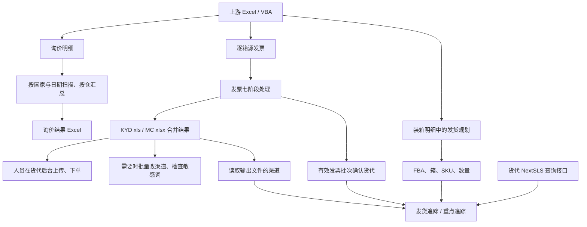
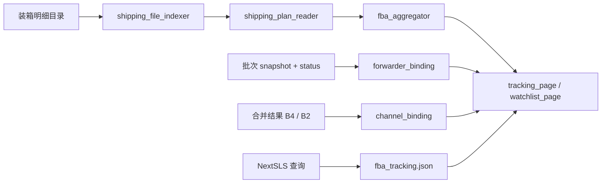

# 项目理解与维护交接

记录日期：2026-10-20（Asia/Shanghai）。

调查基线：`D:\InvoiceMergeSystem`，`dev` 分支，提交 `24ea17f`，应用版本 `1.1.18`。本记录依据当前源码、现有说明书、Git 历史和一次完整测试运行编写；已实现行为、历史说明和待验证事项分别标注。

维护更新（2026-10-20，V1.1.19）：发票中心已加入国家选择、国家目录解析、中央仓库国家校验，以及日期/货代/国家批次隔离；KYD 已支持加拿大文本邮编，并加入浅色界面。下文发票行为同步更新，原接手测试基线和历史调查记录保留。使用方法见[发票国家分流配置](发票国家分流配置.md)，本次发布验证见第 17 节。

## 1. 程序要解决什么问题

本项目服务于多店铺 Amazon FBA 发货工作，把原先分散在 Excel、公司 OneDrive 目录和货代后台中的重复操作集中到一个 Windows 桌面入口。

核心目标有三个：

1. 把各店铺、各仓库的询价明细汇总成可填写物流报价的询价表，减少人工统计重量和箱数。
2. 把逐箱生成的货代发票合并成符合货代官方模板的上传文件，并通过元数据、箱号和文件校验降低漏箱、重复、混仓和模板损坏风险。
3. 从装箱明细还原 FBA 下的 SKU 与数量，结合发票确认货代，再查看运单和物流轨迹，方便找货、催货和截图沟通。

因此，它已经从“发票合并工具”扩展成日常物流辅助工作台。询价中心、发票中心和发货追踪各有自己的数据来源，不能把一条链的成功当作另一条链的数据完整性证明。

上游询价明细和源发票由既有 Excel/VBA 工作流提供；本仓库没有实现这些上游宏。下游货代网页的登录、文件上传和实际下单由人员完成；程序提供网页入口及物流查询接口。

## 2. 日常业务全貌



合并后若要改渠道，应修改“合并结果”里的最终文件。修改“全部发票汇总”中的中间副本，不会自动回写已经生成的最终结果。

## 3. 技术组成与入口

这是本机运行的 Python 桌面应用。当前入口不包含独立 Web 服务或前后端部署。

- `main.py`：初始化日志、Qt 应用、字体、样式和主窗口。
- `app/main_window.py`：侧边导航和页面容器，注册首页、询价、发票、发货追踪、重点追踪、批量修改、敏感词和维护页面。
- `app/pages/`：界面操作、预览表格、后台任务调度、错误提示及打开文件/网页。
- `app/services/`：询价、发票处理、地址库、批量修改和敏感词逻辑。
- `app/services/invoice_adapters/`：按货代及模板版本提供发票读写和输出校验。
- `app/shipment_tracking/`：装箱目录索引、发货规划解析、FBA 汇总、货代/渠道绑定、物流查询和重点清单。
- `app/database/`：SQLAlchemy 货件数据模型和建库接口；当前未成为主界面数据通道。
- `app/workers.py`：统一的 `QThread` 工作线程，通过 Signal 返回结果；使用 Excel COM 时初始化/释放 COM。
- `app/excel_com.py`：独立 Excel 实例及工作簿开关辅助逻辑。MC 为提高批量速度另有整批复用的计算实例。
- `app/json_io.py`：JSON 读取和“写临时文件后替换”的保存方法。
- `app/app_logging.py`：结构化文本日志，记录模块、批次、阶段、文件和异常。
- `InvoiceMergeSystem.spec`：PyInstaller 单文件、无控制台打包配置。

主要依赖的职责：PySide6 负责界面；openpyxl 读写 `.xlsx` 和读取 `.xlsm`；pywin32 调用 Microsoft Excel；xlrd/olefile 读取旧版 `.xls` 及 OLE 流；Pillow 处理产品图片；SQLAlchemy 支持货件数据库基础设施；pytest 提供测试。

## 4. 询价中心如何实现

界面入口：`app/pages/inquiry_page.py`。核心服务：`app/services/inquiry_service.py`。参数：`app/inquiry_config.py`、`app/date_ids.py`。

### 输入与筛选

- 默认扫描 `询价路径/<DateID>/` 中的 `*_询价明细.xlsx`，支持起止日期范围。
- 临时追加扫描只扫描人员选择的目录，不自动混入默认日期目录。
- 读取“询价明细”工作表，要求 SchemaVersion、DateID、StoreCode、PlanID、SourceID、WarehouseCode、FBABatch、CartonNumber、WeightKG 等字段。
- 先选国家，再按 StoreCode 前缀筛选。当前登记“美→美国、加→加拿大、英→英国、德→德国”。
- 校验文件名中的店铺号与表内 StoreCode 一致；已知其他国家的文件跳过，未登记店铺前缀单独列出。

### 校验与汇总

- 以 SHA256 识别整份内容相同的重复文件。
- 校验行数据及文件内部店铺、计划、日期、SourceID 的一致性。
- CartonNumber 在本次扫描中全局唯一；同一 FBA 不得映射多个仓库。
- 重量使用 Decimal 和 ROUND_HALF_UP 保留两位，按仓库累计重量、统计唯一箱数。

### 导出

复制中央 `询价表模板.xlsx` 到本机临时目录，使用 Excel COM 调整“询价单”里的两个 ListObject（“第三步_1”和“第三步”）。A:C 写仓库、重量、总箱数，D:K 为模板报价区域，维护 G/K 的公式。保存后重新打开核对，再复制到正式结果目录。

输出为 `询价结果/<当天DateID>/<当天DateID>_<国家>_询价汇总_<总箱数>箱.xlsx`。扫描可跨天，输出归当天。同日同国家重新生成会替换该国家的结果并清理其他箱数版本；已在上一份结果填写的报价不会迁移到新文件。

## 5. 发票中心如何实现

界面入口：`app/pages/invoice_page.py`。持久化状态：`app/services/batch_service.py`。

### 七个阶段

1. **原始扫描**，`invoice_scan_service.py`：按国家与货代读取对应注册源子目录或手动目录，收集 `.xlsx`，按元数据日期过滤，依据仓库中央地址校验国家和货代，校验后建立/复用批次快照。发现误放文件即失败。
2. **快速合并**，`invoice_fast_merge_service.py`：这一步是按货代/仓库/SourceID 复制并校验原文件，尚未拼接发票内容。记录原路径、复制路径、箱身份和 SHA256。
3. **二次扫描**，`invoice_second_scan_service.py`：比较原始快照、复制清单和重新扫描结果的文件数、机器键、SHA256、货代、仓库、FBA、日期与模板版本。
4. **MergePlan**，`merge_plan_service.py`：按 `(CarrierCode, TemplateVersion, WarehouseCode)` 分组，确定输入、箱号、适配器、输出路径，保存计划和计划哈希。
5. **内容合并**，`invoice_content_merge_service.py`：将输入复制到本机工作目录，调用对应适配器校验和合并，验证输出，再经临时文件发布到合并结果目录。已收集到分组错误时，会尝试删除本次已生成的输出并留下诊断报告。
6. **结果检查**，`invoice_result_check_service.py`：核对计划文件是否存在、是否可读、是否满足适配器规则，再检查敏感词；敏感词命中按警告展示。
7. **完成**，`batch_service.complete_batch()`：必须已经通过结果检查且最终输出完整，再进行输出/中间目录清理，更新为完成。

`invoice_prepare_service.run_prepare_merge()` 把阶段 2、3、4 串起来；恢复中断任务时，根据当前状态跳过已完成部分。界面负责阶段操作，部分服务同时检查状态或前置文件，不能把任意服务函数当作可无条件调用的独立操作。

### 原始发票的身份规则

扫描读取 veryHidden 的 `_SystemMeta` 工作表，而非依赖文件名推断关键身份。必要字段包含：

```text
MetaSchemaVersion / CarrierCode / CarrierName / TemplateVersion
InvoiceType / ChannelCell / DateID / GeneratedAt
StoreCode / PlanID / SourceID / WarehouseCode / FBABatch / CartonNumber
```

- MetaSchemaVersion 当前要求 `1.0`。
- SourceID 必须是 8 位大写十六进制。
- 箱身份机器键为 `(SourceID, CartonNumber)`；箱号还必须在本次扫描中全局唯一。
- CartonNumber 格式为 `FBABatch + U + 六位数字`，不允许 `U000000`。
- 同一 SourceID 的店铺、计划、日期、货代必须一致。
- 同一 FBA 只能对应一个仓库。
- 同一 SourceID 存在不同 GeneratedAt 时，只保留最新生成的一批，旧版本以警告列出。
- 允许的发票货代来自 `current_config.ini`，并与实际注册的适配器取交集。当前适配器只有 `KYD:1.0` 和 `MC:1.0`。
- 原始发票扫描不读取询价明细，也不要求与询价中心先完成对齐。
- 国家来源为 `_SystemMeta.WarehouseCode` 对应中央地址库“国家*”列；`invoice_country_service.py` 统一校验单一货代、单一国家。国家只加到程序记录和计划，不增加源元数据必填字段；实际合并再次验证输入国家、箱身份和 SHA256。

### 批次和输出

批次号形如 `20261020-B0001`，分配时尝试创建目录避免编号占用。同一 DateID、CarrierCode、CountryCode 只保留一个未完成批次；同范围重复出现时保留编号最大者，其余作废。相同内容哈希复用活动批次，快照变化只作废同范围旧批次并新建。缺国家的旧快照按中央地址库解析，无法确定或混国的活动批次需重新扫描，不自动作废其他范围。

主要状态按顺序为：

```text
FIRST_SCAN_PASSED → QUICK_MERGED → SECOND_SCAN_PASSED
→ MERGE_PLAN_READY → CONTENT_MERGED → CHECK_PASSED → COMPLETED
另有 INVALIDATED；兼容旧状态 FIRST_STAGE_PASSED。
```

完成或作废的批次不能通过普通状态更新重新修改。记录目录保留 snapshot、status、manifest、plan、check 等过程文件；最终发票位于单独的合并结果目录。

**结果清理边界**：完成一个新批次时，`complete_batch()` 只尝试删除同一 DateID、货代、国家的其他已完成批次输出 `.xlsx` 和 `.xls`，再清理当前批次“全部发票汇总”目录。其他国家、货代以及无法判断国家的旧结果不自动删除。历史批次 JSON 保留，因此同范围历史记录仍不等于最终文件长期留存。本次仅在重定向测试目录验证完成操作，未执行真实生产批次完成。

## 6. 两家货代不能共用一种写法

### 快越达 KYD

核心文件：`invoice_adapters/kyd_adapter.py`、`kyd_xls_io.py`。

- 源发票为 `.xlsx`，读取“快越达发票”工作表，表头第 29 行、明细第 30 行起。
- 渠道 B4、仓库 B5、箱数 B26；源图片网址在 S 列。
- 最终复制官方 `快越达发票模版.xls`，填写“模板”工作表，输出 `KYD_<仓库>_<箱数>箱.xls`。
- `kyd_xls_io.py` 直接维护 OLE/BIFF 记录、字符串表、行索引、公式缓存和浮动图结构，保留货代识别所需格式。
- 产品图下载后处理成适合旧 `.xls` 的小图；兼容 Amazon URL 返回 WebP 等情况。源发票的图片网址是运行依赖。
- 地址从中央表注入模板页 B6–B13 的缓存，不修改官方模板的地址库原件。
- 邮编保留原始文本或数值，支持加拿大字母数字邮编及美国前导零文本邮编；写入和输出校验均支持文本。
- 同仓 10 箱可以合并成一份；早期“拆成多份”的版本策略已被后续修复替代。
- 输出校验会检查工作表、仓库、箱数、地址、图片对象，以及 Excel 另存可能留下的结构。

**维护原则**：不能为了统一实现，把 KYD 改成 Excel 打开后另存或通用工作簿重建。这里的底层结构处理对应多次真实上传兼容性修复。

### 迈创 MC

核心文件：`invoice_adapters/mc_adapter.py`。

- 源表“迈创发票”，表头第 17 行、明细第 18 行起，读取到 V 列；图片为 R 列 URL。
- 最终模板页“模板”，渠道 B2、仓库 B3、箱数 B16。
- 保留官方模板 B2 的渠道名称，不把源发票旧服务名覆盖过去。
- 复制官方 `迈创发票模板.xlsx`，在本机缓存复制件中注入中央“迈创地址库”，调整地址公式范围。
- 模板和地址库的修改时间、大小组成缓存标记；各仓复制缓存、写入明细，整批复用一个 Excel 实例计算公式。
- 先在本机计算保存，再复制到结果目录，减少 OneDrive 保存冲突。
- 输出为 `MC_<仓库>_<箱数>箱.xlsx`，不把内部批次记录表强加到货代上传模板里。

维护模板字段时，应同时核对源表、输出表、地址公式和输出验证，而不只改页面上的文案。

## 7. 发货追踪与重点追踪

### 当前实际执行的数据链



目录根为 `【采购仓储】/【装箱明细】`，支持 `.xlsm` 和 `.xlsx`，跳过“标签”和临时文件。索引层识别店铺、月份、日期和数字批次子目录，支持 `2026.8` 与 `2026.08` 等月份命名。

当前显示和筛选用的 ship_date 来自目录层的年/月/日；文件名日期单独保留，不能默认等同于发货日期。缺具体日但可识别年月时，日期范围匹配按月份是否与区间重叠判断。

解析器优先匹配店铺对应发货规划表，例如“美3→美国3号-发货规划”；否则匹配唯一的“*-发货规划”工作表。按“FBA批号”“仓库”“长(cm)”“重量(KG)”等标签识别箱列，SKU 在 F 列，ASIN 在 E 列，中文品名优先读 H 列、其次 A 列英文品名。只读取数据，不执行上游宏。

解析结果是 `FBA → Carton → SKU → Qty`。汇总只合计同一个 FBA 下同一 SKU 的各箱数量，不能把不同 FBA 的同 SKU 数量混在一起。页面的一行主要对应一个源发货规划中的一个 FBA/SKU 汇总项。

### 货代、渠道与物流各从哪里来

- **确认货代**：从非 INVALIDATED 的发票批次快照读取 FBA → CarrierCode；多个不同货代显示冲突。
- **候选货代**：来自装箱文件名；未有确认货代时，可用于解析查询代码。当前已知 KYD、MC、HP（皓鹏）、LH（利合）。追踪支持某货代不等于发票合并支持该货代。
- **渠道**：通过快照的 FBA→货代/仓库关系，读取现有合并结果的 KYD“模板!B4”或 MC“模板!B2”。当前渠道读取按货代/仓库汇集多个结果文件，不是逐 FBA 的独立渠道历史；多种文本会显示冲突。
- **Tracking**：中央 `发货追踪/fba_tracking.json` 保存 FBA→运单号、来源和最新物流事件。
- **接口**：`providers/nextsls.py` 从 `forwarder_api.ini` 读取网关和账号，使用 get_info、get_tracking_numbers、get_tracking 等查询；优先外部单号，必要时回退 client_reference，并核对 FBA。
- **多账号**：优先上次命中账号及文件名候选提示，必要时尝试同货代其他账号。
- **人工记录**：来源为 `manual` 的 Tracking 不被自动拉取覆盖。

追踪界面支持店铺、月份或日期范围，以及 FBA/SKU/品名/运单号筛选。“全部店铺 + 全部月份”在页面上被限制；从货代拉取查询的是当前筛选结果中的 FBA，按 FBA 去重。

重点追踪以“店铺 + 品名包含 + 可选 SKU 包含”保存共享条件，进入页面后按最近 60 天读取；默认隐藏已签收。当前已签收判断依赖最新事件文本包含“已签收/已送达/delivered”，不是完整物流生命周期引擎。

### 数据库代码目前处于什么位置

`app/database/models/shipment.py` 已定义 11 张表：货代、渠道、货件、SKU 明细、箱、运单、轨迹、ETA 历史、异常、接口同步日志和审计日志。另有状态枚举、Repository、ShipmentService、货件编号和源指纹逻辑及对应测试。

但 `main.py` 和当前页面没有调用 `make_engine()`、`create_schema()` 或 `ShipmentService`，`tracking_pull.py` 也写的是 JSON 覆盖层。数据库默认路径是 `LOCAL_ROOT/data/shipment_tracking.sqlite`，不是当前页面启动即创建的正式业务库。

这些是已有、受测试覆盖的数据库基础能力，不能描述成当前页面已经落库、已具备完整 ETA/异常工作流。后续是否接入应单独确定范围，不能在修追踪页面时假定两套路径已经同步。

## 8. 批量修改、敏感词与地址维护

### 批量修改单元格

入口 `batch_edit_page.py`，服务 `batch_modify_service.py`。支持 `.xlsx` 和 `.xls`，有预览、目标单元格标准化、锁文件预检、临时备份和回读校验。扫描同时包含源发票与合并结果时，优先保留合并结果文件。

KYD `.xls` 通过二进制写入函数改单元格；`.xlsx` 使用 Excel COM 保存。失败时尝试回滚已登记的成功修改项；这不是跨文件的数据库事务，不能据此保证所有中途异常都能完整恢复。临时备份在本机 temp 中，正常成功会删除，也不是长期备份。

### 敏感词

入口 `sensitive_page.py`，服务 `sensitive_word_service.py`。词库和物流扫描规则保存在中央 `公共配置/sensitive_words.json`。

检查产品英文/中文品名和材质；支持字段范围、分类、启用状态、白名单短语，处理不可见字符和空白，英文关键词忽略大小写。命中结果包含文件、工作表、单元格、原文和关键词，可导出汇总/明细，也可通过批量修改逻辑写回人员选中的单元格。

发票第 6 阶段复用此检查，命中按警告记录，不直接作为结构校验失败。词库为空会产生提示。

### 地址维护

`address_library.py` 只读中央 `各物流地址库.xlsx` 的“快越达地址库”“迈创地址库”。维护页提供打开该文件的入口，并不是配置后台或数据库管理界面。新增仓库地址维护此中央表，不修改官方模板原件。

## 9. 文件、配置与持久化

中央 SYSTEM_ROOT 目前硬编码在配置模块中：

```text
I:\OneDrive\OneDrive - Lion\【采购仓储】\【发货单】\【发票合并】\发票系统
├─ 公共配置/
│  ├─ current_config.ini          发票货代配置
│  ├─ invoice_sources.ini         发票扫描源
│  ├─ forwarder_api.ini           查询账号、网关与 Token
│  └─ sensitive_words.json        敏感词及扫描规则
├─ 模板/                         询价、KYD、MC 官方模板
├─ 询价路径/<日期>/               上游询价明细
├─ 询价结果/<输出日期>/           询价汇总
├─ 批次记录/<日期>/<批次号>/
│  ├─ snapshot.json / snapshot.sha256 / status.json
│  ├─ quick_merge_manifest.json / second_scan.json
│  ├─ merge_plan.json / result_check.json
│  └─ content_merge_diagnose.txt  合并失败时生成
├─ 全部发票汇总/<批次号>/         快速合并的中间副本
├─ 合并结果/<日期>/<批次号>/       最终上传文件
└─ 发货追踪/
   ├─ fba_tracking.json
   └─ watchlist.json
```

目录树展示的是各阶段可能存在的文件，不表示每个批次已经产生全部文件。其他中央资源：

- 手动发票扫描默认目录：`SYSTEM_ROOT.parent/物流商发票`。
- 地址库：`【发货单】/发货单各源抓取/各物流地址库.xlsx`。
- 装箱明细：`【采购仓储】/【装箱明细】`。

本机日志与临时文件：源码模式固定 `D:\InvoiceMergeSystem`；打包模式先测试 exe 同目录下 logs、temp 是否可写，失败时回退 `%LOCALAPPDATA%\InvoiceMergeSystem`。MC 模板缓存单独使用 `%LOCALAPPDATA%\InvoiceMergeSystem\cache`，即使主日志目录可写也会使用该位置。

`write_json()` 采用临时文件替换以降低单次写入不完整的概率，但没有跨电脑锁、版本合并或 OneDrive 分布式事务。不能把共享文件夹等同于支持同时编辑的数据库。

## 10. 运行、测试和发布现状

### 本机已核实环境

- Python 3.11.4；PySide6 6.11.2；openpyxl 3.1.5；pywin32 312。
- pytest 9.1.1；Pillow 12.3.0；xlrd 1.2.0；olefile 0.47。
- SQLAlchemy 2.0.52；PyInstaller 6.22.2。

这些是本机 `.venv` 的实测版本，不是项目已经锁定的依赖版本。`requirements.txt` 仅固定 xlrd 为 1.2.0、限制 SQLAlchemy 为 2.x，其余主要依赖没有固定版本；PyInstaller 没有列入该文件。

本次只检查存在性，确认中央业务目录、装箱明细目录、三份模板、中央地址库和三份 INI 在当前机器可见；没有读取或记录真实 Token，也没有请求真实货代接口。

### 常用命令

在项目根目录执行：

```powershell
# 启动桌面程序
& .\.venv\Scripts\python.exe main.py

# 完整测试；pytest.ini 已配置项目路径与测试目录
& .\.venv\Scripts\python.exe -m pytest -q

# 针对发票或追踪相关测试
& .\.venv\Scripts\python.exe -m pytest -q tests/test_invoice_sources.py tests/test_merge_plan.py
& .\.venv\Scripts\python.exe -m pytest -q tests/shipment_tracking

# 使用已有打包配置；本次未执行
& .\.venv\Scripts\python.exe -m PyInstaller --noconfirm InvoiceMergeSystem.spec
```

启动及选择扫描范围并非纯查看操作：发票页选择货代和国家后会恢复当天对应活动批次，可能补写旧记录、处理同范围重复活动批次。询价文件收集还会尝试删除识别为 Excel/OneDrive 临时文件的条目，敏感词配置读取可能初始化或升级配置。因此开发验证应使用样本副本和重定向的测试路径。

### 测试覆盖内容

- 询价文件收集、国家筛选、日期范围、重复/一致性规则。
- 发票扫描源、批次复用/作废、快速复制、二次扫描、准备合并、MergePlan、完成时输出保护。
- KYD 二进制模板填写、图片及多箱结构；MC 字段、官方模板和地址库。
- 批量修改、敏感词和日志目录回退。
- 装箱索引、发货规划解析、FBA 数量汇总、货代/渠道绑定、Tracking 覆盖层、NextSLS 查询适配与重点清单。
- 数据库模型、Repository、货件创建、事务回滚、编号唯一性和幂等。

部分测试在中央文件缺失时直接 `return`，没有显式报告 skipped；通过数不能证明那些真实模板分支都已执行。接口测试主要使用替身，不证明真实账号可用或货代实际接受上传。

### 2026-10-20 基线结果

运行：

```powershell
& .\.venv\Scripts\python.exe -m pytest -q --basetemp='D:\InvoiceMergeSystem\temp\codex-baseline-20261020'
```

结果：**190 passed、1 failed、2 warnings，22.73 秒，退出码 1**。

失败用例为 `tests/test_mc_adapter.py::test_merge_group_copies_official_template`。调用链：

```text
McAdapter.merge_group()
→ _calculate_local()
→ _mc_calculator()
→ win32com.client.DispatchEx("Excel.Application")
→ pywintypes.com_error: -2147024891 / 0x80070005（拒绝访问）
```

随后以独立最小调用初始化 COM 并激活 Excel，没有读取发票也复现同一 HRESULT；同时确认 `Excel.Application` 的 CLSID 注册项存在。由此可确定本次失败发生在当前执行环境的 Excel 激活边界，而非通过这次测试已发现了发票内容错误。具体桌面会话、权限或系统策略原因尚未确定；也未验证普通用户直接启动程序时是否同样失败。

两条 warning 来自 openpyxl，提示某项 Data Validation extension 不受支持、保存时会被移除。当前记录不据此推断货代一定拒收，后续模板变更和 MC 输出验收时需关注。

上述为原接手调查的验证记录；当时没有修改业务代码或测试，也没有为了得到绿色结果替换 Excel 计算或跳过失败项。后续国家分流修改及验证见第 15 节。未进行真实询价导出、生产批次合并/完成、货代上传验收或真实物流查询。

### 发布约束

`InvoiceMergeSystem.spec` 包含 `app`、win32com、win32timezone、pythoncom、pywintypes 等隐式依赖，以及 `kyd_et_cell_image_data.bin`。它不会把 OneDrive 中央模板、地址库、扫描源和 Token 一并打进 exe。

发版至少同步版本常量、spec 中的 exe 名称和说明书，再在可调用 Microsoft Excel 的 Windows 桌面环境验证。KYD 上传与图片、MC 渠道/地址公式、跨天输出和 OneDrive 写入都属于已有历史修复范围，不能只以打包成功作为业务可用的证据。

## 11. Git 仓库情况与接手方式

2026-10-20 读取到的本地状态：

- 当前分支：`dev`，HEAD 为 `24ea17f`（2026-10-09，V1.1.18 国家筛选）。
- 上游：`origin/dev`；相对本地保存的上游引用领先/落后为 0/0。
- 本地 `main` 和 `origin/main` 为 `60417a9`，`dev` 相对本地 `main` 多 12 个提交。
- 远程 origin：`https://github.com/mylife20250103-cell/FHZZ.git`。
- 调查开始时工作区干净。本次新增维护文档并给早期调查添加历史标识，未改变业务代码。
- 本次没有 fetch、pull、切换分支、commit、push 或改写历史。上述同步状态只针对现有本地引用，不代表已核实 GitHub 当前最新状态。

后续修复先核对当前分支和未提交修改，默认从当前有效业务代码建立 `codex/<修复主题>` 分支，按问题做小范围修复并保留回归证据。是否提交、推送、合并和发布依具体任务范围执行。

Git 当前跟踪的是源码、测试、打包配置和文档。被忽略的有 `.venv/`、`temp/`、`logs/`、`build/`、`dist/`、`release/`、环境文件和 Python 缓存。OneDrive 业务数据在仓库外；因此 Git 版本管理不能替代业务数据、模板、配置和安装包的备份。

本机 dist 中已有 v1.1.18 exe，但它处于忽略目录，本次没有重新构建或验证该二进制。若未来正式启用本地数据库，当前 `.gitignore` 还没有专门排除 `data/*.sqlite`，应随落库方案一起明确处理。

## 12. 现有维护关注点

以下是接手时的证据和验证缺口，不表示本次已实施修复：

1. **Excel 激活失败**：完整测试仅此一项失败，最小调用复现；当前执行环境的权限原因待查，桌面端验收仍缺失。
2. **同日旧结果清理**：国家分流维护已将范围限制到同日、同货代、同国家；该范围内旧完成批次的输出仍会清理，不能视作长期归档。
3. **路径固定且重复配置**：业务路径固定 I 盘；源码本机目录固定 D 盘；`invoice_config.py` 与 `inquiry_config.py` 都声明 SYSTEM_ROOT，测试临时目录也固定。换机器不只是复制代码。
4. **共享文件并发**：批次、重点清单和 Tracking JSON 没有跨机器写锁；MC 缓存也使用固定文件名。同一批次不应并行执行生产内容合并。
5. **历史资料过时**：早期 `current_system_map.md` 中“没有装箱索引/解析/API”等描述已被后续提交替代，应结合本文和当前代码阅读。
6. **自动化测试混合真实环境**：存在真实模板和真实装箱明细依赖，缺文件直接 return。后续可在单独测试改进任务中区分独立回归与环境集成测试。
7. **敏感词递归目录的扩展名差异**：`scan_paths()` 对单文件和非递归目录支持 `.xls`，但递归目录分支复用了仅收集 `.xlsx` 的 `collect_invoice_files()`。因此目录内 KYD `.xls` 的递归覆盖不能等同于直接选择文件时的覆盖；本次静态核实，未改动。
8. **渠道关联粒度**：当前渠道按货代/仓库跨输出汇集，可能因历史不同渠道显示冲突，不能解释为逐 FBA 的完整渠道履历。
9. **依赖可复现性**：主要依赖没有锁定，PyInstaller 不在 requirements；本机版本已记录，但新环境尚无完整安装/构建验收。
10. **数据库与现用链并存**：完整货件数据模型存在，但 UI 仍走文件，未来接入时需要明确迁移和唯一事实源，不能直接叠加写入。

这些关注点按具体故障或需求逐项处理。原接手调查只建立记录；后续国家分流维护的行为变更见第 15 节。

## 13. 后续定位问题的入口

- 询价统计、国家或重复文件：先看 `inquiry_service.py`、`inquiry_config.py` 与 `test_inquiry_collect.py`。
- 发票漏扫、旧版本混入、箱号问题：先看 `invoice_scan_service.py`、源 `_SystemMeta` 和批次 `snapshot.json`。
- 批次恢复、状态异常、旧结果消失：先看 `batch_service.py`、批次 `status.json` 及 `test_batch_service.py`、`test_complete_batch.py`。
- 复制丢文件、SHA 不一致：先看 `invoice_fast_merge_service.py`、`invoice_second_scan_service.py` 和复制 manifest。
- 仓库分组或输出名称：先看 `merge_plan_service.py`、`merge_plan.json`。
- KYD 上传图片/结构：先看 `kyd_adapter.py`、`kyd_xls_io.py`、`test_kyd_xls_fill.py`，保留问题文件副本。
- MC 服务名、地址、计算或性能：先看 `mc_adapter.py`、中央模板/地址库、本机 cache 和 Excel 激活情况。
- 内容合并失败：先查看对应批次 `content_merge_diagnose.txt` 和 `logs/app.log`，再追到具体适配器。
- 追踪数量错误：先看 `shipping_plan_reader.py` 和 `fba_aggregator.py`；不要先修改运单覆盖层。
- 货代、渠道或运单错误：依次看 `forwarder_binding.py`、`channel_binding.py`、`carrier_resolve.py`、`tracking_pull.py`、`nextsls.py` 和 `fba_tracking.json` 的来源标记。
- 重点清单或已签收筛选：先看 `watchlist.py`、`watchlist_page.py`。
- 批量修改或敏感词：先看 `batch_modify_service.py`、`sensitive_word_service.py` 和对应测试。

## 14. 本次交接记录

已完成：梳理用途和业务流程；核对当前页面与服务调用；区分现用文件链和数据库基础能力；检查关键路径存在性、版本和 Git 本地状态；运行完整测试并定位唯一失败的执行边界；记录运行、测试、发布和维护约束。

交付：根目录 README、AGENTS 维护入口、本交接文档，以及早期追踪调查的历史提示。

尚未验证：普通 Windows 桌面中的 Excel COM 激活、真实货代接口账号、实际上传下单兼容性、新环境安装和本次重新打包。后续出现具体维护问题时，应在本基线之上追加问题、证据、修改及验证结果。

## 15. 发票国家分流维护（2026-10-20，源码待发布）

按用户确认实施：上游生成源发票时按国家分目录，发票中心选择国家和货代扫描；程序不负责生成或移动源发票，也不改写中央扫描源配置。原配置指向货代“未合并”根目录时自动追加国家子目录；另支持 `CountryCode` 加直接国家路径的显式配置。

新增 `invoice_country_service.py`，统一中央仓库国家解析和批次/计划校验。国家、货代检查先于旧代文件筛选；旧代误放也会导致失败。快照和计划记录国家，实际合并复核源元数据和 SHA256。批次按日期、货代、国家独立恢复、复用和清理。KYD 文本邮编通过 BIFF 公式缓存写入，不改为 Excel 另存。

验证结果：受限环境内初始全量为 190 passed / 1 failed，失败发生在迈创本机缓存写入权限；允许在受限环境外运行后，修改前基线为 191 passed，最终全量为 **217 passed / 1 warning**（23.17 秒）。原 Excel COM 激活失败在本次受限环境外回归中未复现；未通过替换计算或跳过测试消除失败。警告为既有 openpyxl Data Validation extension 提示。

新增 26 项用例，覆盖国家数据与目录解析、未知/冲突/错国/错货代拦截、旧代误放、独立批次恢复与清理、旧快照解析、计划及输入复核、KYD 官方二进制模板中的加拿大文本邮编，以及 Qt 界面的国家切换与任务期间禁用。测试使用样本副本或重定向目录；只读代码审查发现的旧代绕过问题已通过红灯用例复现、修正并复核。

尚未执行：生产批次扫描/合并/完成、美国或加拿大货代实际导入、真实桌面全流程、新安装包构建与发布。程序版本及打包名称暂未变更，已有 exe 不包含本次功能。

## 16. 浅色界面维护（2026-10-20，源码待发布）

用户确认仅优化视觉，保留现有操作代码。`app/styles.py` 统一全局样式及按钮、状态提示、步骤、统计值、路径和表格视觉规则；`app/ui_icons.py` 在内存中绘制统一线性图标。导航路径及顺序保持原样，首页卡片保留原有内容和入口。默认表格行高为 34，保留各页面既有列宽、选择、编辑及排序设置。

发票中心和询价中心的 `build_ui()` 加入滚动容器，保留原控件、事件和操作顺序；日期行使用紧凑布局。维护、物流详情及敏感词等页面同步使用主题。`app/assets/ui/chevron-down.svg` 为下拉箭头，`InvoiceMergeSystem.spec` 只新增该资源目录的打包项，程序名与版本未变更。

通过改版前源码快照对比确认：20 个业务服务文件 SHA256 不变；全部既有信号绑定表达式及 `main.py` 不变；除纯呈现构建部分外，188 个页面、导航及卡片方法剔除视觉 setter 后语法树一致。3 个界面构建方法的差异为图标、布局和滚动容器，未更改业务调用、条件或数据设置。

已使用本机字体、隔离扫描源和只读替身渲染全部 8 个页面，未执行生产扫描或物流请求。现有 5 项界面回归通过，完整测试为 **217 passed / 1 warning**（24.35 秒），保留既有 openpyxl 提示。本次没有增加镜像式样式测试，没有重新打包或修改 OneDrive 业务文件；真实 Windows 桌面的显示缩放和后续新安装包仍需验收。重启源码版可加载新主题。

只读审查另在隔离环境检查了 1250×760 窗口：发票与询价页均可滚动到原底部按钮；表格编辑和选择设置不变；按钮禁用态、导航选中态及 SVG 资源路径正确，未发现源码交付阻断点。

## 17. V1.1.19 发布（2026-10-20）

用户授权发版并推送 Git。版本常量、EXE 名称和当前操作说明统一为 V1.1.19；第 15、16 节的“源码待发布”和“未打包”为实施阶段历史记录，发布状态以本节为准。发布基于 `dev@24ea17f`，推送前已核对 `origin/dev`，无远端新增提交；本次不合并或改写 `main`。

发布前完整测试：**217 passed / 1 warning，22.17 秒，退出码 0**。警告仍为 openpyxl Data Validation extension；未替换 Excel 计算或跳过失败。UI 不变量检查再次确认 20 个业务服务文件、188 个非呈现方法、原有信号绑定及 `main.py` 与 UI 改版前一致。

使用本机虚拟环境执行 `python -m PyInstaller --noconfirm InvoiceMergeSystem.spec`，构建退出码 0，生成 `dist/发票合并系统_V1.1.19.exe`。发布包包含 EXE、操作说明、版本说明、国家目录配置和 SHA256 校验文件；OneDrive 业务发票、官方模板、地址库和公共 INI 不随包分发。

EXE 归档检查通过：236 个归档条目、953 个 Python 模块，包含国家校验服务、UI 图标、QtSvg、`win32timezone`，内置版本常量为 `1.1.19`；下拉 SVG 和 KYD 图片数据与源码资源逐字节一致。发布 ZIP 共 7 个文件，已验证文件清单、CRC、包内外 EXE SHA256 一致；外部校验文件为 `release/SHA256SUMS-v1.1.19.txt`。Git 标签使用 `v1.1.19`，二进制资产通过 GitHub Releases 分发，`dist/`、`release/` 继续保持 Git 忽略。

本次未执行生产批次扫描、合并、完成或真实物流请求；美国/加拿大货代后台的实际导入、桌面缩放及新机器首次启动仍需实际验收。测试和打包成功不等同于这些业务验收已完成。
